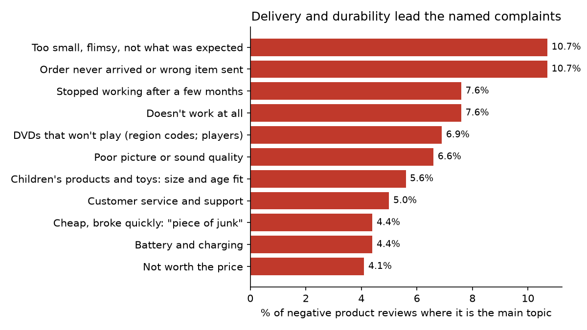
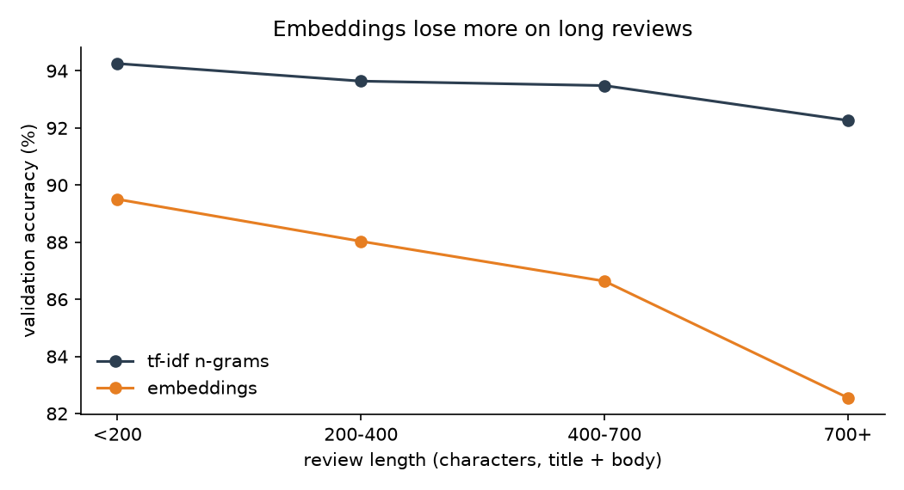
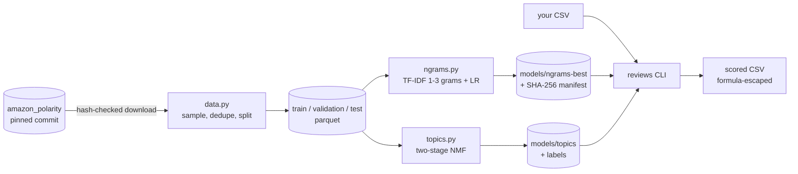

# review-sentiment-insights

Telling positive from negative Amazon product reviews, and finding what unhappy customers complain about, using the public amazon_polarity dataset.

The point is to do the classic text-classification project carefully:

- check for duplicate reviews leaking between train and test;
- beat a word-list baseline before claiming anything;
- read the model's real mistakes;
- only report complaint topics a person can actually name;
- score the test set once, at the end.

**Result:** TF-IDF on 1-3 word n-grams with logistic regression gets **93.2%** on 400,000 held-out test reviews (95% CI 93.1 to 93.3). That's 21 points above the VADER word list. A sentence-embedding model came 6.5 points lower.

## Demo

```text
$ uv run reviews score --in sample.csv --out scored.csv
scored 6 reviews: 4 negative; wrote scored.csv

$ uv run reviews topics --in sample.csv
4 of 6 reviews scored negative
      1   25.0%  Stopped working after a few months
      1   25.0%  Customer service and support
      1   25.0%  Order never arrived or wrong item sent
      1   25.0%  DVDs that won't play (region codes; players)
```

`scored.csv` is the input with `prob_positive` and `sentiment` added. "Not bad at all, sturdy and works well" scores 0.99 positive. A review whose text starts with `=HYPERLINK(...)` is written as `'=HYPERLINK(...)`, so Excel shows it as text instead of running it.



## Features

- `reviews score`: adds sentiment and a probability to any CSV with a `text` column (optional `title`).
- `reviews topics`: names the main complaint of each review scored negative, using 15 topics labelled by hand.
- `reviews holdout`: scores the chosen model on the test set and refuses to do it a second time.
- Models load only if their SHA-256 matches. The hash can be pinned in the environment, and that pin beats the manifest. A model saved by a different scikit-learn version is refused.
- Input is capped at 50 MB and 200k rows. Encoding must be UTF-8, column names must be unique, and every row must have as many fields as the header. Anything else is rejected with a message rather than guessed at.

## Results

Validation (20,000 reviews), accuracy with a bootstrap 95% interval:

| Model | Accuracy |
|---|---|
| Majority class | 50.0% |
| Review length only | 53.5% |
| VADER word list (no training) | 72.1% (71.5 to 72.7) |
| Naive Bayes, 1-2 grams | 88.8% |
| Bag of words + logistic regression | 89.7% |
| TF-IDF words + logistic regression | 90.4% (90.0 to 90.8) |
| Sentence embeddings (MiniLM) + logistic regression | 87.0% (86.5 to 87.4) |
| Linear SVM, 1-2 grams | 93.1% |
| **TF-IDF 1-3 grams + logistic regression (chosen)** | **93.5% (93.1 to 93.8)** |

On the **test set** (400,000 reviews, scored once), the chosen model gets **93.2%** (93.1 to 93.3). It has an AUC of 0.980 and an expected calibration error of 0.013, so a probability of 0.8 means about 80%.

What the work found:

- **Word pairs fix negation.** On 2,305 validation reviews with a negated sentiment word ("not good", "not bad"), accuracy goes from 88.9% with single words to 93.9% with 1-3 grams.
- **The title matters.** Adding the review title to the body is worth 2.2 to 2.8 points. The learning curve is still rising at 200k reviews, so more data would help.
- **Most remaining mistakes aren't model bugs.** In 50 random mistakes, read by hand:
  - 16 were mixed reviews;
  - 15 aimed their praise or blame at something else (another edition, the seller);
  - 10 had misleading wording;
  - 3 were sarcastic;
  - 2 had labels that contradict the text.
- **Complaints, once books, films and music are set aside:** delivery problems (10.7%) and "too small, flimsy" (10.7%) lead, then stopped working after months (7.6%), doesn't work at all (7.6%), DVDs that won't play (6.9%) and customer service (5.0%). The shares hold within 0.6 points on validation.
- **Embeddings lose, mostly on long reviews.** MiniLM reads 256 tokens and averages them, so the gap to TF-IDF grows from 4.8 points under 200 characters to about 10 points over 700. Encoding 200k reviews took 2 h 7 min on a laptop CPU.



## Stack

Python 3.12, uv, pandas, scikit-learn, PyTorch (CPU) and transformers for the embedding comparison, matplotlib, pytest, ruff. CI: GitHub Actions with ruff, pytest, a CLI smoke test, pip-audit and Gitleaks.

## Architecture



Sixteen decisions with their reasons, plus a STRIDE threat model, are in [docs/ARCHITECTURE.md](docs/ARCHITECTURE.md).

## Data

[amazon_polarity](https://huggingface.co/datasets/fancyzhx/amazon_polarity) (Zhang, Zhao and LeCun, 2015, from McAuley and Leskovec's Amazon reviews), Apache-2.0. It isn't committed: a script downloads a pinned commit and checks each file's SHA-256. The data is sampled to 200k train and 20k validation, with the full 400k test set. Test is left as the dataset ships it. Instead, train and validation drop any review whose text (normalised) also appears in test (13 did), plus repeats within the pool (5).

## Quick start

```bash
uv sync
make data      # downloads 1.15 GB once, checks hashes, writes data/processed
make ngrams    # fits the n-gram grid on validation and saves the winner to models/ngrams-best
make topics    # fits the complaint topics and saves them to models/topics
uv run reviews score --in your_reviews.csv --out scored.csv
make lint test
```

Models aren't committed (the sentiment model is 43 MB), so they're trained locally. `make embeddings` reruns the embedding comparison. That takes about two hours on CPU.

## Structure

```text
src/reviews/   data, text cleaning, models, evaluation, model store, topics, embeddings, CLI, holdout
notebooks/     01 EDA · 02 model comparison · 03 explanations · 04 errors · 05 topics · 06 embeddings
reports/       JSON results with data hashes and git commit, labelled errors and topics, figures
tests/         139 tests, including bad CSVs, tampered models and formula injection
docs/          ARCHITECTURE.md
```

## Limitations

- **Binary labels.** The data has no neutral or 3-star reviews, so a lukewarm review is forced into one class. Mixed reviews are the biggest group of mistakes.
- **Labels come from star ratings, not the text.** About 1 in 25 "mistakes" is a review whose text contradicts its stars.
- **One domain, one era.** English Amazon reviews, mostly from before 2014. Accuracy on other shops, languages or newer slang isn't known.
- **Topics are one per review**, and the data has no product category or date, so complaints can't be split by department or tracked over time.
- **The model file is a pickle.** It's hash-checked before loading and tied to the exact scikit-learn version, which means retraining after an upgrade.
- **The scrubber over-masks.** It hides any run of 7 or more digits, so some product codes are blanked in report excerpts.
- **It's an analysis tool,** not a moderator. Around 7% of reviews are misclassified, so it shouldn't remove reviews or reply to customers by itself.

## License

MIT
