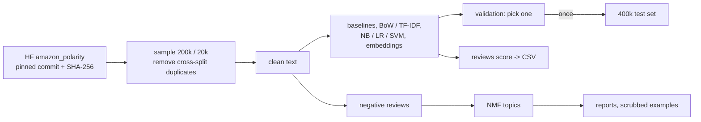

# Architecture

## Context

An offline NLP project that runs on one laptop, with no server and no cloud. It answers two questions about product reviews:

1. **Is a review positive or negative?** A classifier, measured against simple baselines.
2. **What do unhappy customers complain about?** Topics in the negative reviews that a product team could act on.

The output is a reproducible pipeline, notebooks, reports and a small CLI. The CLI scores a CSV of reviews and lists the top complaint topics. It's the classic text-classification project, done carefully: duplicate checks between train and test, error analysis on real mistakes, and the words the model relies on, not only a headline accuracy.

## Data

[`fancyzhx/amazon_polarity`](https://huggingface.co/datasets/fancyzhx/amazon_polarity) (Zhang, Zhao and LeCun, 2015, built from McAuley and Leskovec's Amazon reviews), Apache-2.0.

- **Content:** each row has a title, a review body and a label. Negative means 1 or 2 stars and positive means 4 or 5; 3-star reviews were removed. The classes are balanced.
- **Size:** 3.6M train and 400k test rows.
- **Pinned copy:** dataset commit `9d9c45c18f8c3cf1b23a3c27917b60cbf28f3289`. Each of the 5 parquet files (1.15 GB in all) is checked against the SHA-256 that Hugging Face lists for it.
- **Laptop-sized sample:** 200k train rows and a 20k validation set, stratified, drawn from all four train files with a fixed seed.

## Setup

| Item | Choice | Why |
|---|---|---|
| Task | Binary sentiment, then complaint topics on the negative reviews | The labels support exactly this |
| Split | The dataset's own test set stays untouched until the end; validation comes from train | Same "score once" rule as demand-forecasting |
| Text | Title and body joined as `title. body` | Titles often carry the verdict ("Waste of money"). Ablated once to see how much they add |
| Duplicate checks | Exact and near-duplicate reviews across train, validation and test, found by hashing normalised text. They're reported and removed from train and validation | Review datasets repeat text, and a test review that also sits in train inflates accuracy |
| Metrics | Accuracy and F1 for the negative class, with bootstrap intervals; a reliability curve for calibration | Accuracy alone can hide a model that's worse on complaints, and complaints are what a team acts on |
| Baselines | Majority class; the VADER sentiment lexicon | Anything has to beat a word list to count |
| Models | Bag-of-words vs TF-IDF, then logistic regression, Naive Bayes, linear SVM and n-grams, then sentence embeddings + logistic regression | One change at a time, so each gain can be traced to its cause |
| Topics | NMF on TF-IDF of negative reviews, with k chosen by coherence and by reading the top reviews per topic | Topics nobody can name aren't findings |

## Components

| Component | Where | What it does |
|---|---|---|
| Data | `src/reviews/data.py` | Pinned download, hash check, sample, duplicate report |
| Text | `src/reviews/text.py` | One cleaning function for training and scoring (HTML entities, whitespace, case), kept minimal and tested |
| Models | `src/reviews/models.py` | Baselines and the linear models, saved with a hash manifest |
| Explain | `src/reviews/explain.py` | Words pushing each class; per-review contributions |
| Topics | `src/reviews/topics.py` | NMF on negative reviews, topic labels, example reviews per topic |
| Scrub | `src/reviews/scrub.py` | Masks emails, phone numbers and URLs in any review text that goes into a report |
| CLI | `src/reviews/cli.py` | `reviews score --in file.csv --out scored.csv`, `reviews topics` |
| Notebooks | `notebooks/` | EDA, model comparison, error analysis (50 labelled mistakes), topics |

## Data flow

## Decisions

| # | Decision | Why |
|---|----------|-----|
| 1 | amazon_polarity, not Yelp or Amazon Reviews 2023 | Apache-2.0, so results and models can be published. Yelp's terms are non-commercial and restrict redistribution. Amazon Reviews 2023 is richer (stars, categories, dates), but no licence is stated |
| 2 | 200k train / 20k validation, full 400k test | Enough for the linear models to level off while staying fast on a laptop. Learning curves on day 4 check that claim. The sample seed and sizes go in every report |
| 3 | VADER as the lexicon baseline | MIT licence, small, no training. It's the "word list" any model must beat |
| 4 | Topics only on negative reviews, NMF over LDA | The question is what people complain about. NMF on TF-IDF usually gives easier-to-read topics than LDA on short text, and runs in seconds. If its topics can't be named, LDA gets tried |
| 5 | The test set is scored once, by a separate command that refuses to run twice | Every choice before then is made on validation, as in demand-forecasting |
| 6 | Saved models are loaded from the bytes whose SHA-256 was checked against a manifest | A scikit-learn model is a pickle, and loading a pickle runs code. Models here are local artifacts, never downloaded, but a swapped file still mustn't load silently. Same as prompt-injection-guard |
| 7 | Review text in reports, notebooks and topic examples goes through the scrubber and is cut to 300 characters | Reviews can contain names, emails and phone numbers. The data is public, but there's no reason to copy that into a portfolio |
| 8 | The scored CSV escapes text cells starting with `=`, `+`, `-`, `@`, tab or carriage return | Review text is user-written and the file will be opened in Excel (formula injection). Same guard as demand-forecasting |
| 9 | The CLI caps input at 50 MB and 200k rows, requires a `text` column, and rejects anything else instead of guessing | A huge or malformed file should fail fast with a clear message |
| 10 | Sentence embeddings use `all-MiniLM-L6-v2` (Apache-2.0) on CPU, on a 50k subsample if the full 200k is too slow | It's small enough for a laptop, and the comparison is about whether embeddings beat TF-IDF here, not about the best possible model |
| 11 | Every run writes the data hashes, parameters and git commit next to its results | A number in the README can be traced to the exact run that produced it |

## Limitations (known before starting)

- Binary labels: no neutral or mixed reviews, and no star rating to predict.
- One domain (Amazon products), English only, mostly reviews from before 2014.
- No product category or date, so complaint topics can't be split by product type or followed over time.
- Sarcasm and negation ("not bad at all") are a known weakness of bag-of-words models. The error analysis will count them.
- The labels come from star ratings, not from reading the text. Some reviews have text that contradicts their stars, and those count as model "mistakes".

## Threat model (STRIDE)

The system is offline: no network service, no accounts, no secrets. The risks are in the data coming in and the files going out.

| | Threat | Mitigation |
|---|---|---|
| Spoofing | A look-alike dataset or a changed upstream copy is downloaded instead | The download is pinned to a dataset commit, and every file's SHA-256 is checked before use |
| Tampering | A saved model file is swapped | A hash manifest is checked, and the model is loaded from the checked bytes (decision 6) |
| Tampering (output) | Review text in the scored CSV runs as a spreadsheet formula | The output escapes formula-like cells (decision 8) |
| Repudiation | A reported number can't be traced to a run | Run metadata is saved with every result (decision 11) |
| Information disclosure | Personal details in reviews end up in reports or notebook outputs | Scrubber and 300-character excerpts (decision 7); notebook outputs are checked before commit |
| Denial of service | A huge or malformed input CSV | Size and row caps, strict column checks (decision 9) |
| Elevation (misuse) | The classifier gets used to auto-moderate reviews or auto-reply to customers | The README says it's an analysis tool, and errors are shown by class so its weak spots are visible |
